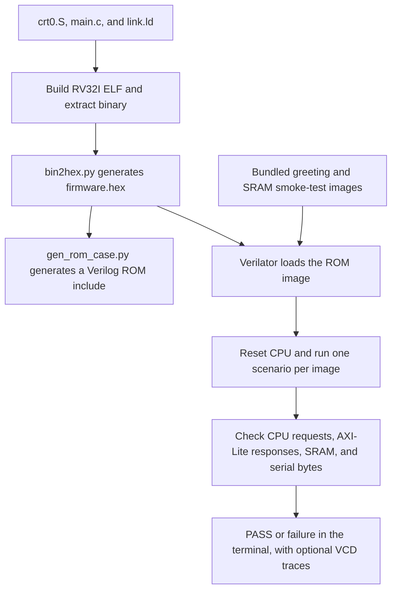
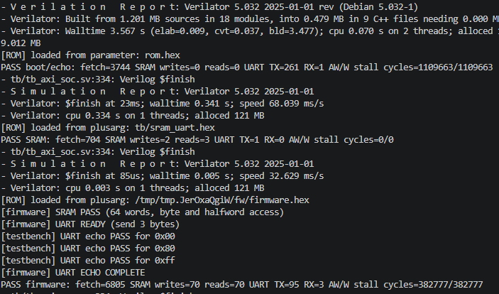

# PicoRV32 AXI-Lite UART SoC

## Purpose

This project demonstrates how a bare-metal RV32I program boots from ROM, accesses SRAM through AXI-Lite, and communicates over a memory-mapped UART. It provides a simulation baseline for later synthesis and RTL development. The testbench follows transactions from the PicoRV32 memory interface to the selected peripheral and checks what actually appears on the serial pins.

The main design lives in [`src/`](src/). The repository also includes an earlier [native-bus SoC](picoRV32/README.md) under `picoRV32/`. Each version has its own firmware, RTL, and testbench.

## Architecture


The top-level ports are `clk`, active-high `reset`, `uart_tx`, and `uart_rx`. After reset, the CPU fetches its first instruction at `0x00000000`. The bridge treats a zero `cpu_mem_wstrb` as a read and a nonzero strobe as a write. It handles the AXI address and data handshakes and completes the CPU request when the slave responds. The UART runs at 115,200 baud with 8N1 framing when `clk` is 50 MHz. [Top-level RTL](src/top.v) · [AXI-Lite interconnect](src/axi_lite_interconnect.v)

### Firmware memory map

| Resource | Firmware address | Behavior |
| --- | --- | --- |
| ROM | `0x00000000`–`0x00001FFF` | 2,048 32-bit words for boot code and read-only data |
| SRAM | `0x00010000`–`0x000100FF` | 64 32-bit words with byte-write enables |
| UART TX | `0x10000000` | Write a byte for transmission. The slave delays acceptance while the TX buffer is full. |
| UART RX | `0x10000004` | Read the received byte in bits `[7:0]` and consume the buffered value. |
| UART status | `0x10000008` | Bit 1 indicates received data. Bit 0 reads zero in `src`. |

The decoder selects a 64 KiB window for each memory, and the smaller ROM and SRAM arrays repeat within those windows. The UART occupies a 16-byte decode window. Addresses outside the three windows currently route to ROM. [Address decoder](src/axi_decoder.v) · [SRAM](src/sram.v) · [UART registers](src/uart_axi.v)

## Project contents

| Path | Contents |
| --- | --- |
| [`src/top.v`](src/top.v), [`src/picorv32.v`](src/picorv32.v) | SoC integration, CPU, and native-to-AXI-Lite bridge |
| [`src/axi_decoder.v`](src/axi_decoder.v), [`src/axi_lite_interconnect.v`](src/axi_lite_interconnect.v) | Target selection and routing for the five AXI-Lite channels |
| [`src/rom.v`](src/rom.v), [`src/rom.hex`](src/rom.hex), [`src/sram.v`](src/sram.v) | Boot ROM, bundled greeting image, and writable memory |
| [`src/uart_axi.v`](src/uart_axi.v), [`src/uart_tx.v`](src/uart_tx.v), [`src/uart_rx.v`](src/uart_rx.v) | AXI-facing UART registers and serial transmit/receive logic |
| [`src/fw/`](src/fw/) | Startup assembly, C verification firmware, linker script, and ROM image generators |
| [`src/tb/`](src/tb/) | Self-checking SystemVerilog bench, SRAM smoke-test ROM, and GTKWave layout |
| [`src/run.sh`](src/run.sh) | Firmware build and three-scenario Verilator runner |
| [`picoRV32/`](picoRV32/) | Native-memory-bus variant with its own simulation workflow |

## Build and verification workflow

Use Bash on Linux or WSL, GNU Make, a RISC-V GCC and binutils toolchain, Python 3, timing-capable Verilator, and a C++ compiler supported by that Verilator build. GTKWave is used to inspect waveforms. The default RISC-V tool prefix is `riscv64-unknown-elf`. Set `CROSS` to use a different prefix.

From the repository root, run the complete AXI-Lite regression.

```bash
bash src/run.sh
```

To build the firmware separately and keep its artifacts, run `make -C src/fw`. The Makefile writes `firmware.elf`, `firmware.bin`, `firmware.hex`, and `firmware_rom_case.vh` into `src/fw/build/`. The regular regression builds its own copy in a temporary directory. [Firmware Makefile](src/fw/Makefile)



### Verification method

The testbench checks the reset-vector fetch and subsequent ROM reads. On the AXI-Lite bus, it checks address routing, request and response handshakes, and that a stalled channel holds `VALID` and its payload stable. It models expected SRAM contents from writes and their byte strobes, then compares the model against actual read data. For UART, it independently decodes each TX frame and compares the serial byte with both the accepted AXI write and the expected output. RX checks drive the serial input and verify the byte returned to the CPU and echoed on TX. A mismatch, CPU trap, or timeout fails the run. [Testbench](src/tb/tb_axi_soc.sv)

| Scenario | ROM image | Pass criteria |
| --- | --- | --- |
| Boot and echo | `src/rom.hex` | Fetch from the reset vector, transmit ten greetings, observe AXI write backpressure, and echo `0xA5`. |
| SRAM smoke test | `src/tb/sram_uart.hex` | Write `0x11223344`, update one byte so it reads back as `0x11225A44`, and send `Z` over UART. |
| Full firmware | Generated `firmware.hex` | Check all 64 SRAM words, byte and halfword writes, signed and unsigned loads, then echo `0x00`, `0x80`, and `0xFF`. |

The full verification firmware first tests SRAM without using the stack. It then initializes the stack and enters `main.c`, which reports the memory result and handles UART echo. A passing run records 70 SRAM writes, 70 SRAM reads, and three received bytes. [Startup assembly](src/fw/crt0.S) · [C firmware](src/fw/main.c)



### Waveform inspection

From the repository root, enable tracing and open the SRAM smoke test with the provided GTKWave layout.

```bash
bash src/run.sh --waves
gtkwave src/waves/sram.vcd src/tb/axi_soc.gtkw
```

The runner writes `boot_echo.vcd`, `sram.vcd`, and `firmware.vcd` under `src/waves/`. In the SRAM trace, follow the first write to `0x00010000` with `WSTRB=0xF`, then the byte write with `WSTRB=0x2`. The SRAM response changes from `0x11223344` to `0x11225A44` before a write to `0x10000000` starts the UART frame for `Z`. The view groups CPU requests, AXI-Lite channels, SRAM responses, and serial pins. [GTKWave layout](src/tb/axi_soc.gtkw)


## Synthesis and further development

Use `top` as the synthesis top and the nine RTL files listed by `src/run.sh` as inputs. Build the intended firmware first so the ROM contents are available. In simulation, `rom.v` loads a hex file. With `SYNTHESIS` defined, it uses a Verilog case table. The built-in table contains the bundled greeting image. To use the generated firmware instead, set `ROM_CASE_FILE` to the quoted filename `"firmware_rom_case.vh"` and add `src/fw/build/` to the tool's Verilog include search path. The generated case table has already passed the full firmware test in Verilator with `SYNTHESIS` enabled. [RTL source list](src/run.sh) · [ROM selection](src/rom.v) · [Case generator](src/fw/gen_rom_case.py)

The current milestone is RTL simulation. Technology mapping, resource or area estimates, and timing are future milestones. The UART configuration assumes a 50 MHz input, which corresponds to a 20 ns clock period for the initial synthesis constraint.

The following behaviors define useful follow-up tests as the design grows.

| Area | Follow-up work | References |
| --- | --- | --- |
| Address map | Align the decoded windows with the implemented depths and add directed tests for unmapped addresses and writes to ROM. Update the bundled greeting image’s stack address when tightening SRAM decoding because that image currently uses an SRAM alias. | [Decoder](src/axi_decoder.v) · [Bundled boot image](src/rom.hex) |
| UART receive | The current RX buffer holds one byte and can overwrite unread data. Add tests for bursts and a byte arriving as the CPU consumes the previous one. The current regression sends one byte at a time and waits for its echo. | [UART RX buffer](src/uart_axi.v) · [RX stimulus](src/tb/tb_axi_soc.sv) |
| AXI-Lite timing | The CPU bridge presents `AW` and `W` together. Add independent channel timing tests before connecting a different master, particularly for write data arriving before a valid write address. | [CPU bridge](src/top.v) · [Write routing](src/axi_lite_interconnect.v) |
