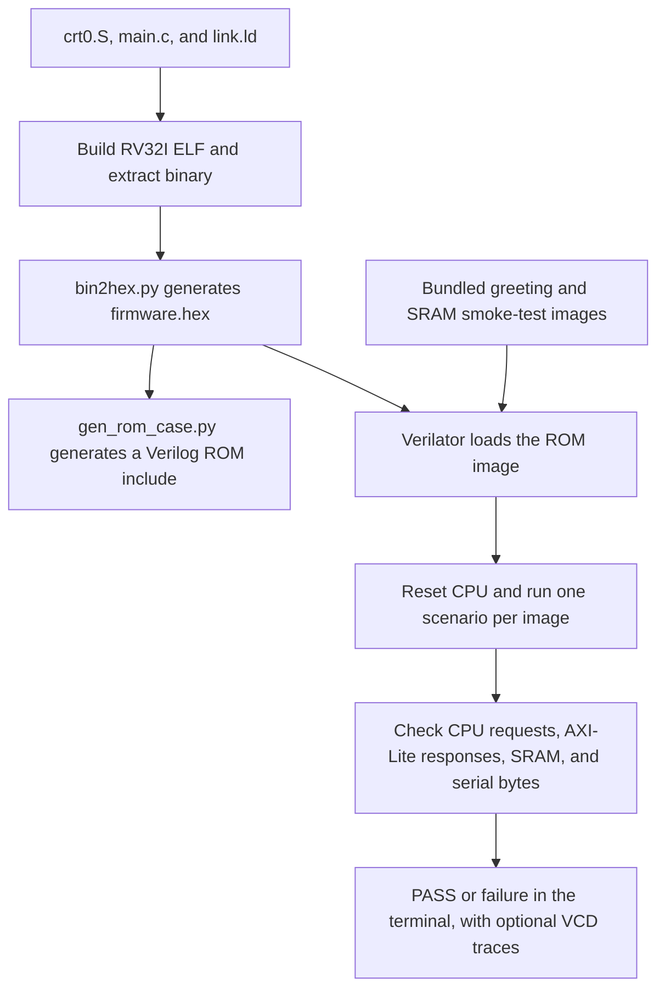
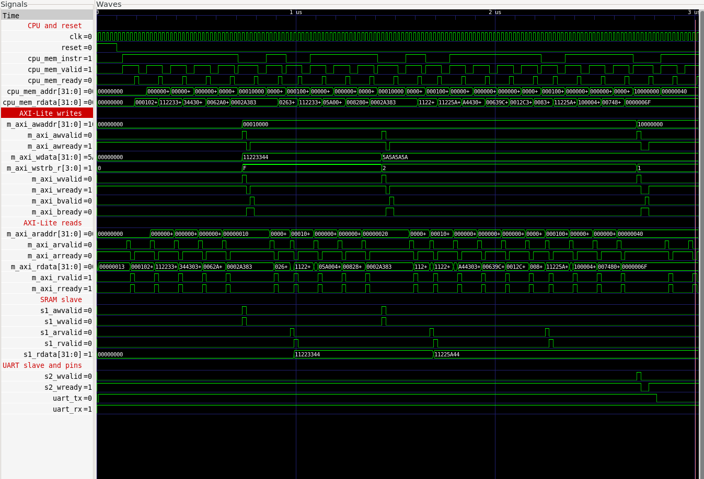
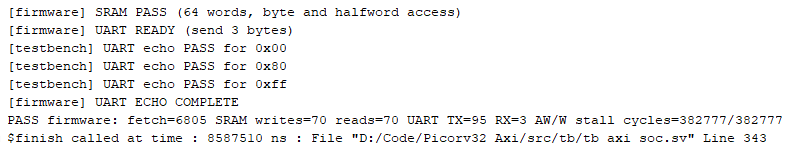

# PicoRV32 AXI-Lite SoC

This SoC boots bare-metal RV32I firmware from ROM, accesses SRAM through AXI-Lite, and communicates over a memory-mapped UART. All three behavioral scenarios passed in Vivado Simulator (XSim). Vivado 2026.2 synthesized the design for the Artix-7 **`xc7a35tcpg236-1`** using a 50 MHz clock constraint. The synthesized design uses 1,989 slice LUTs and 2,942 flip-flops and reports +13.985 ns worst setup slack.

The main design lives in [`src/`](src/). The repository also includes an earlier [native-bus SoC](picoRV32/README.md) under `picoRV32/`. Each version has its own firmware, RTL, and testbench.

## Architecture


The top-level ports are `clk`, active-high `reset`, `uart_tx`, and `uart_rx`. After reset, the CPU fetches its first instruction at `0x00000000`. The bridge treats a zero `cpu_mem_wstrb` as a read and a nonzero strobe as a write. It handles the AXI address and data handshakes and completes the CPU request when the slave responds. The UART runs at 115,200 baud with 8N1 framing when `clk` is 50 MHz. [Top-level RTL](src/top.v) · [AXI-Lite interconnect](src/axi_lite_interconnect.v)

### Firmware memory map

| Resource | Firmware address | Behavior |
| --- | --- | --- |
| ROM | `0x00000000`–`0x00001FFF` | 2,048 32-bit words for boot code and read-only data |
| SRAM | `0x00010000`–`0x000100FF` | 64 32-bit words with byte-write enables |
| UART TX | `0x10000000` | Write a byte for transmission. The slave delays acceptance while the TX buffer is full. |
| UART RX | `0x10000004` | Read the received byte in bits `[7:0]` and consume the buffered value. |
| UART status | `0x10000008` | Bit 1 indicates received data. Bit 0 reads zero in `src`. |

The decoder selects a 64 KiB window for each memory, and the smaller ROM and SRAM arrays repeat within those windows. The UART occupies a 16-byte decode window. Addresses outside the three windows currently route to ROM. [Address decoder](src/axi_decoder.v) · [SRAM](src/sram.v) · [UART registers](src/uart_axi.v)

## Project contents

| Path | Contents |
| --- | --- |
| [`src/top.v`](src/top.v), [`src/picorv32.v`](src/picorv32.v) | SoC integration, CPU, and native-to-AXI-Lite bridge |
| [`src/axi_decoder.v`](src/axi_decoder.v), [`src/axi_lite_interconnect.v`](src/axi_lite_interconnect.v) | Target selection and routing for the five AXI-Lite channels |
| [`src/rom.v`](src/rom.v), [`src/rom.hex`](src/rom.hex), [`src/sram.v`](src/sram.v) | Boot ROM, bundled greeting image, and writable memory |
| [`src/uart_axi.v`](src/uart_axi.v), [`src/uart_tx.v`](src/uart_tx.v), [`src/uart_rx.v`](src/uart_rx.v) | AXI-facing UART registers and serial transmit/receive logic |
| [`src/fw/`](src/fw/) | Startup assembly, C verification firmware, linker script, and ROM image generators |
| [`src/tb/`](src/tb/) | Self-checking SystemVerilog bench, SRAM smoke-test ROM, and GTKWave layout |
| [`src/run.sh`](src/run.sh) | Firmware build and three-scenario Verilator runner |
| [`picoRV32/`](picoRV32/) | Native-memory-bus variant with its own simulation workflow |

## Firmware build and Verilator regression

Use Bash on Linux or WSL, GNU Make, a RISC-V GCC and binutils toolchain, Python 3, timing-capable Verilator, and a C++ compiler supported by that Verilator build. GTKWave is used to inspect waveforms. The default RISC-V tool prefix is `riscv64-unknown-elf`. Set `CROSS` to use a different prefix.

From the repository root, run the complete AXI-Lite regression.

```bash
bash src/run.sh
```

To build the firmware separately and keep its artifacts, run `make -C src/fw`. The Makefile writes `firmware.elf`, `firmware.bin`, `firmware.hex`, and `firmware_rom_case.vh` into `src/fw/build/`. The regular regression builds its own copy in a temporary directory. [Firmware Makefile](src/fw/Makefile)



### Verification method

The testbench checks the reset-vector fetch and subsequent ROM reads. On the AXI-Lite bus, it checks address routing, request and response handshakes, and that a stalled channel holds `VALID` and its payload stable. It models expected SRAM contents from writes and their byte strobes, then compares the model against actual read data. For UART, it independently decodes each TX frame and compares the serial byte with both the accepted AXI write and the expected output. RX checks drive the serial input and verify the byte returned to the CPU and echoed on TX. A mismatch, CPU trap, or timeout fails the run. [Testbench](src/tb/tb_axi_soc.sv)

| Scenario | ROM image | Pass criteria |
| --- | --- | --- |
| Boot and echo | `src/rom.hex` | Fetch from the reset vector, transmit ten greetings, observe AXI write backpressure, and echo `0xA5`. |
| SRAM smoke test | `src/tb/sram_uart.hex` | Write `0x11223344`, update one byte so it reads back as `0x11225A44`, and send `Z` over UART. |
| Full firmware | Generated `firmware.hex` | Check all 64 SRAM words, byte and halfword writes, signed and unsigned loads, then echo `0x00`, `0x80`, and `0xFF`. |

The full verification firmware first tests SRAM without using the stack. It then initializes the stack and enters `main.c`, which reports the memory result and handles UART echo. A passing run records 70 SRAM writes, 70 SRAM reads, and three received bytes. [Startup assembly](src/fw/crt0.S) · [C firmware](src/fw/main.c)


### Waveform inspection

From the repository root, enable tracing and open the SRAM smoke test with the provided GTKWave layout.

```bash
bash src/run.sh --waves
gtkwave src/waves/sram.vcd src/tb/axi_soc.gtkw
```

The runner writes `boot_echo.vcd`, `sram.vcd`, and `firmware.vcd` under `src/waves/`. In the SRAM trace, follow the first write to `0x00010000` with `WSTRB=0xF`, then the byte write with `WSTRB=0x2`. The SRAM response changes from `0x11223344` to `0x11225A44` before a write to `0x10000000` starts the UART frame for `Z`. The view groups CPU requests, AXI-Lite channels, SRAM responses, and serial pins. [GTKWave layout](src/tb/axi_soc.gtkw)



## Vivado project setup

The captured runs used Vivado 2026.2 on Windows. Install Vivado with 7 Series device support and create an **RTL Project**. On the **Parts** tab, select `xc7a35tcpg236-1`. Use the following source sets so the behavioral and synthesis runs pick up the same RTL.

| Vivado source set | Files and settings |
| --- | --- |
| Design Sources | From `src/`, add `top.v`, `picorv32.v`, `axi_decoder.v`, `axi_lite_interconnect.v`, `rom.v`, `sram.v`, `uart_axi.v`, `uart_rx.v`, and `uart_tx.v`. Set `top` as the design top. |
| Simulation Sources | Add `src/tb/tb_axi_soc.sv` as SystemVerilog and set `tb_axi_soc` as the simulation top. Choose **Vivado Simulator** as the target simulator. |
| Constraints | Create `clk.xdc` with the command below and add it to the project constraints. |

```tcl
create_clock -name soc_clk -period 20.000 [get_ports clk]
```

The testbench drives a 20 ns clock with reset asserted for the first five falling edges. The XDC applies the equivalent clock period to synthesis and static timing analysis. The UART divider uses 434 clock cycles per bit, giving 8.680 µs per bit at 50 MHz. [Testbench](src/tb/tb_axi_soc.sv) · [UART clock configuration](src/top.v) · [Clock report](clocks.rpt)

### Run behavioral simulation in XSim

1. From the repository root, build the full firmware with `make -C src/fw` in Bash or WSL. This creates `src/fw/build/firmware.hex`. The boot and SRAM images are already in the repository.
2. In **Settings → Simulation → Simulation**, set `xsim.simulate.xsim.more_options` to the options for one scenario below. Replace `D:/Code/Picorv32_Axi` with the absolute path to your checkout. XSim runs from its generated simulation directory, so an explicit `romhex` path lets both the RTL ROM and the testbench load the same image. [Vivado Simulator options (UG900)](https://docs.amd.com/r/en-US/ug900-vivado-logic-simulation/Vivado-Simulator-Simulation-Options)
3. Select **Run Simulation → Run Behavioral Simulation**. Enter `run all` in the Tcl Console and check the final `PASS` line and `$finish`. Close the simulation before changing options and launching the next scenario.

| Scenario | XSim options |
| --- | --- |
| Boot and echo | `-testplusarg romhex=D:/Code/Picorv32_Axi/src/rom.hex` |
| SRAM smoke test | `-testplusarg sram_test -testplusarg romhex=D:/Code/Picorv32_Axi/src/tb/sram_uart.hex` |
| Full firmware | `-testplusarg firmware_test -testplusarg romhex=D:/Code/Picorv32_Axi/src/fw/build/firmware.hex` |

### XSim results

| Scenario | Instruction fetches | SRAM writes / reads | UART TX / RX bytes | AW / W stall cycles | Simulated finish time |
| --- | ---: | ---: | ---: | ---: | ---: |
| [Boot and echo](UartSim.png) | 3,744 | 0 / 0 | 261 / 1 | 1,109,663 / 1,109,663 | 22.742590 ms |
| [SRAM smoke test](SramSim.png) | 704 | 2 / 3 | 1 / 0 | 0 / 0 | 85.270 µs |
| [Full firmware](FwSim.png) | 6,805 | 70 / 70 | 95 / 3 | 382,777 / 382,777 | 8.587510 ms |

Finish times are simulated from time zero. Fetch totals include instruction fetches during polling and idle loops while the testbench waits for UART activity.

- **Boot and echo.** The CPU fetches from the reset vector, sends ten greeting lines, and echoes the input byte `0xA5`. The testbench counts a stall when `VALID` is high and `READY` is low. The sustained TX traffic exercises UART backpressure on both AXI-Lite write channels. A single 8N1 frame takes 86.8 µs, so serial transmission accounts for most of the simulated runtime. [Boot and echo console](UartSim.png)
- **SRAM smoke test.** A full-width store writes `0x11223344` at `0x00010000`. A store to byte lane 1 using `WSTRB=0x2` changes the word to `0x11225A44`. The three SRAM reads cover the original word, the updated word, and the byte load that supplies `0x5A` for the UART frame. The testbench decodes that frame as `Z`. [Smoke-test program](src/tb/sram_uart.hex) · [SRAM console](SramSim.png)
- **Full firmware.** The test checks reads and writes across all 64 SRAM words, exercises byte and halfword access, and verifies signed and unsigned loads. After the SRAM pass message, the testbench sends `0x00`, `0x80`, and `0xFF` one at a time and checks every echo on the TX pin. [Firmware console](FwSim.png)



### Run synthesis and export the reports

1. Use the default Vivado synthesis strategy and select **Run Synthesis**. With the default setup, Vivado takes the `SYNTHESIS` branch of `rom.v` and compiles the built-in greeting case table into the design. The behavioral `romhex` plusarg selects an image only at simulation runtime.
2. When synthesis completes, select **Open Synthesized Design** and run these commands in the Tcl Console. They write the reports and functional netlist to a `synthesis_results` directory under the console's current directory. [Vivado synthesis (UG901)](https://docs.amd.com/r/en-US/2026.1-English/ug901-vivado-synthesis/Running-Synthesis-with-Tcl) · [Netlist export (UG835)](https://docs.amd.com/r/2023.2-English/ug835-vivado-tcl-commands/write_verilog)

```tcl
file mkdir synthesis_results
report_clocks -file synthesis_results/clocks.rpt
report_utilization -file synthesis_results/utilization.rpt
report_timing_summary -file synthesis_results/timing_summary.rpt
write_verilog -mode funcsim synthesis_results/picorv32_axi_funcsim.v
```

To synthesize the full verification firmware, generate `firmware_rom_case.vh` with `make -C src/fw`, add `src/fw/build/` to Vivado's Verilog include directories, and define `ROM_CASE_FILE` with the quoted value `"firmware_rom_case.vh"` for synthesis. Rerun synthesis and export fresh reports for that ROM image. [ROM selection](src/rom.v) · [Vivado include files (UG901)](https://docs.amd.com/r/en-US/ug901-vivado-synthesis/Include-Files)

### Resource utilization

| Resource | Used | Available | Utilization |
| --- | ---: | ---: | ---: |
| Slice LUTs | 1,989 | 20,800 | 9.56% |
| LUTs as logic | 1,941 | 20,800 | 9.33% |
| LUTs as distributed RAM | 48 | 9,600 | 0.50% |
| Slice registers (all flip-flops) | 2,942 | 41,600 | 7.07% |
| Block RAM tiles | 0 | 50 | 0.00% |
| DSP slices | 0 | 90 | 0.00% |
| Bonded I/O blocks | 4 | 106 | 3.77% |
| Global clock buffers | 1 | 32 | 3.13% |

The LUT breakdown is included in the 1,989 total. The 64 × 32-bit SoC SRAM accounts for 2,048 flip-flops, about 70% of all slice registers. Vivado warning `[Synth 8-4767]` attributes the register mapping to the asynchronous-reset-sensitive SRAM process. The netlist also shows distributed RAM in the PicoRV32 register file. Multiplication and division are disabled in the CPU configuration, and synthesis uses zero DSP slices. [Utilization report](utilization.rpt) · [Functional netlist](picorv32_axi_funcsim.v) · [SRAM RTL](src/sram.v) · [CPU configuration](src/top.v)

### Timing at 50 MHz

| Check | Worst slack | Total negative slack | Failing / total endpoints |
| --- | ---: | ---: | ---: |
| Setup | +13.985 ns | 0.000 ns | 0 / 6,848 |
| Hold | +0.108 ns | 0.000 ns | 0 / 6,848 |
| Pulse width | +8.750 ns | 0.000 ns | 0 / 3,031 |

- **Setup.** The worst path runs from the AXI write-address register bit `m_axi_awaddr_reg[29]` to the interconnect's write-response FSM register `FSM_sequential_b_state_reg[1]`. Vivado reports five LUT levels and 5.864 ns of data-path delay. Estimated routing contributes 4.617 ns, about 79% of that delay. [Timing summary](timing_summary.rpt)
- **Hold and pulse width.** The tightest hold path runs from the CPU's `latched_rd_reg[3]` to a distributed register-file RAM write-address input. The shortest reported high or low clock pulse is 10.000 ns against a 1.250 ns minimum at a RAM clock pin. [Timing summary](timing_summary.rpt)
- **Constraint coverage.** Vivado reports zero unconstrained internal endpoints. The two non-clock inputs (`reset` and `uart_rx`) and the output (`uart_tx`) have no external I/O delays in the report. These synthesis estimates use unplaced logic. Board-level validation requires pin and I/O constraints for the chosen board, a review of the asynchronous UART RX and reset paths, and timing analysis after placement and routing. [Clock report](clocks.rpt) · [Timing summary](timing_summary.rpt)

### Functional netlist

The exported netlist contains the device-mapped logic for post-synthesis functional simulation with AMD's primitive models. The three console captures document behavioral simulation. Vivado warning `[Synth 8-7137]` flagged a possible simulation mismatch involving set/reset priority in the SRAM mapping. To exercise SRAM in a post-synthesis functional run, synthesize the SRAM smoke-test or full firmware ROM and check its UART output with a testbench that uses the four top-level ports. The behavioral testbench references internal RTL signals directly, and synthesis can change those names and widths. SDF timing simulation requires a timing netlist and a separately generated SDF file. [Functional netlist](picorv32_axi_funcsim.v) · [Vivado simulation guide (UG900)](https://docs.amd.com/r/en-US/ug900-vivado-logic-simulation/Running-Post-Synthesis-and-Post-Implementation-Simulations)

## Further verification

| Area | Follow-up work | References |
| --- | --- | --- |
| Address map | Align the decoded windows with the implemented depths and add directed tests for unmapped addresses and writes to ROM. Update the bundled greeting image’s stack address when tightening SRAM decoding because that image currently uses an SRAM alias. | [Decoder](src/axi_decoder.v) · [Bundled boot image](src/rom.hex) |
| UART receive | The current RX buffer holds one byte and can overwrite unread data. Add tests for bursts and a byte arriving as the CPU consumes the previous one. The current regression sends one byte at a time and waits for its echo. | [UART RX buffer](src/uart_axi.v) · [RX stimulus](src/tb/tb_axi_soc.sv) |
| AXI-Lite timing | The CPU bridge presents `AW` and `W` together. Add independent channel timing tests before connecting a different master, particularly for write data arriving before a valid write address. | [CPU bridge](src/top.v) · [Write routing](src/axi_lite_interconnect.v) |
