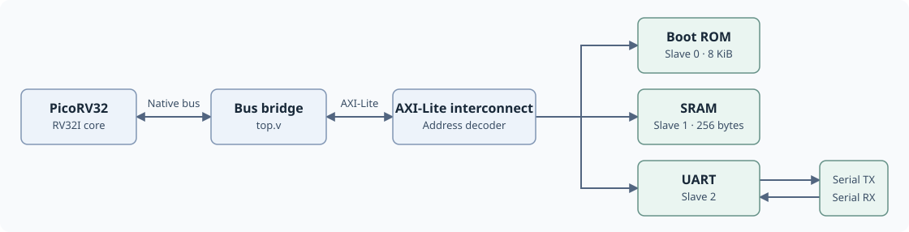
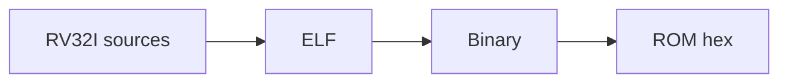

# PicoRV32 AXI-Lite SoC

This SoC runs bare-metal RV32I firmware from ROM and reaches SRAM and a memory-mapped UART through AXI-Lite. All three XSim behavioral tests passed. Vivado 2026.2 synthesized the design for Artix-7 **`xc7a35tcpg236-1`** at a **50 MHz** clock constraint, using **1,989 slice LUTs** and **2,942 flip-flops** with **+13.985 ns** worst setup slack.

[Architecture](#architecture) · [Firmware build](#firmware-build) · [Simulation](#behavioral-simulation) · [Synthesis](#vivado-synthesis) · [Repository layout](#repository-layout)

## Architecture



The CPU starts fetching at `0x00000000` after reset. The bridge sends a read when `cpu_mem_wstrb` is zero and a write when it is nonzero. It completes the CPU request when the selected AXI-Lite slave responds. The top-level ports are `clk`, active-high `reset`, `uart_rx`, and `uart_tx`. At 50 MHz, the UART uses 434 cycles per bit for nominal 115,200 baud with 8N1 framing. [Top-level RTL](src/top.v) · [AXI-Lite interconnect](src/axi_lite_interconnect.v)

### Memory map

| Resource | Firmware address | Behavior |
| --- | --- | --- |
| ROM | `0x00000000`–`0x00001FFF` | 2,048 × 32-bit words for boot code and read-only data |
| SRAM | `0x00010000`–`0x000100FF` | 64 × 32-bit words with byte-write enables |
| UART TX | `0x10000000` | Write a byte. A full TX buffer stalls the write. |
| UART RX | `0x10000004` | Read and consume the buffered byte in bits `[7:0]`. |
| UART status | `0x10000008` | Bit 1 indicates RX data. Bit 0 reads zero. |

ROM and SRAM each decode a 64 KiB window and mirror their physical contents inside it. The UART decodes a 16-byte window. Other addresses route to ROM. [Address decoder](src/axi_decoder.v) · [UART registers](src/uart_axi.v)

## Firmware build

From the repository root, use Bash on Linux or WSL with GNU Make, Python 3, and RISC-V GCC and binutils. The default tool prefix is `riscv64-unknown-elf`. Set `CROSS` to select a different prefix.

```bash
make -C src/fw
```



The [firmware Makefile](src/fw/Makefile) compiles `crt0.S` and `main.c` with `link.ld`. It writes `firmware.elf`, `firmware.bin`, and `firmware.hex` under `src/fw/build/`. It also generates `firmware_rom_case.vh` from the hex image for synthesis.

## Behavioral simulation

Both simulators use `tb_axi_soc`, a self-checking testbench with a 20 ns clock. It checks the reset-vector fetch, AXI-Lite routing and handshakes, and payload stability under stalls. It models SRAM byte writes and independently decodes UART frames, comparing the wire output against the AXI writes and the expected bytes. A mismatch, CPU trap, or timeout fails the run. [Testbench](src/tb/tb_axi_soc.sv)

| Scenario | ROM image | Test coverage |
| --- | --- | --- |
| Boot and echo | [`src/rom.hex`](src/rom.hex) | Ten greetings, UART write backpressure, and echo of `0xA5` |
| SRAM smoke test | [`src/tb/sram_uart.hex`](src/tb/sram_uart.hex) | Word store, byte-lane update, readback, and transmission of `Z` |
| Full firmware | `src/fw/build/firmware.hex` | All 64 SRAM words, byte and halfword writes, signed and unsigned loads, and echoes of `0x00`, `0x80`, and `0xFF` |

### Verilator

Run from the repository root with timing-capable Verilator and a supported C++ compiler. The runner builds the firmware in a temporary directory and runs all three scenarios. [Runner](src/run.sh) · [Verilator console](src/tb_RESULT.png)

```bash
bash src/run.sh
```

To capture waveforms and open the SRAM test in GTKWave, run the following commands.

```bash
bash src/run.sh --waves
gtkwave src/waves/sram.vcd src/tb/axi_soc.gtkw
```

The runner writes `boot_echo.vcd`, `sram.vcd`, and `firmware.vcd` under `src/waves/`. In the SRAM trace, follow the write at `0x00010000` with `WSTRB=0xF`, the byte update with `WSTRB=0x2`, and the write at `0x10000000` that sends `Z`. [SRAM waveform](src/WaveResult.png)

### Vivado project setup

Create an **RTL Project** with 7 Series device support. Select **`xc7a35tcpg236-1`** on the **Parts** tab, then configure the source sets below. This project also serves the synthesis workflow.

| Source set | Files and settings |
| --- | --- |
| Design Sources | Add these nine files from `src/` and set `top` as the design top. |
| Simulation Sources | Add `src/tb/tb_axi_soc.sv` as SystemVerilog, set `tb_axi_soc` as the simulation top, and choose **Vivado Simulator**. |
| Constraints | Add `clk.xdc` with the Tcl clock constraint below. |

```text
top.v  picorv32.v  axi_decoder.v  axi_lite_interconnect.v
rom.v  sram.v      uart_axi.v     uart_rx.v  uart_tx.v
```

```tcl
create_clock -name soc_clk -period 20.000 [get_ports clk]
```

### Run XSim

1. Build the full firmware with `make -C src/fw`. The other two ROM images are bundled.
2. In **Settings → Simulation → Simulation**, set `xsim.simulate.xsim.more_options` to one line from the block below. The lines are for boot and echo, SRAM smoke test, and full firmware, in that order. Replace `D:/Code/Picorv32_Axi` with your checkout's absolute path so the RTL ROM and testbench load the same image. [Vivado Simulator options (UG900)](https://docs.amd.com/r/en-US/ug900-vivado-logic-simulation/Vivado-Simulator-Simulation-Options)
3. Choose **Run Simulation → Run Behavioral Simulation**, then enter `run all` in the Tcl Console. Check the final `PASS` and `$finish` lines. Close the simulation before changing options for the next run.

```text
-testplusarg romhex=D:/Code/Picorv32_Axi/src/rom.hex
-testplusarg sram_test -testplusarg romhex=D:/Code/Picorv32_Axi/src/tb/sram_uart.hex
-testplusarg firmware_test -testplusarg romhex=D:/Code/Picorv32_Axi/src/fw/build/firmware.hex
```

### XSim results

All three scenarios passed in Vivado 2026.2 on Windows. Finish times are measured in simulated time from time zero. Fetch counts include polling and idle loops.

| Console capture | Fetches | SRAM writes / reads | UART TX / RX | AW / W stall cycles | Finish time |
| --- | ---: | ---: | ---: | ---: | ---: |
| [Boot and echo](UartSim.png) | 3,744 | 0 / 0 | 261 / 1 | 1,109,663 / 1,109,663 | 22.742590 ms |
| [SRAM smoke test](SramSim.png) | 704 | 2 / 3 | 1 / 0 | 0 / 0 | 85.270 µs |
| [Full firmware](FwSim.png) | 6,805 | 70 / 70 | 95 / 3 | 382,777 / 382,777 | 8.587510 ms |

- **Boot and echo.** Each 8N1 frame takes 86.8 µs at 50 MHz, so serial transmission accounts for most of the runtime. The sustained stream stalls both AXI-Lite write channels while the TX buffer is full. Each stall counter counts cycles with `VALID` high and `READY` low.
- **SRAM smoke test.** The three reads check the original word `0x11223344`, the word after the lane-1 byte update (`0x11225A44`), and the byte load that supplies `0x5A` (`Z`) for UART transmission.
- **Full firmware.** Startup assembly tests SRAM before setting up the stack. The C program then reports the SRAM result and echoes the three test bytes, which the testbench sends and verifies one at a time. [Startup assembly](src/fw/crt0.S) · [C firmware](src/fw/main.c)

## Vivado synthesis

1. Select **Run Synthesis** with the default strategy. The synthesis branch in `rom.v` compiles the bundled greeting ROM as a case table. The `romhex` simulation option selects the image at runtime.
2. Select **Open Synthesized Design** and run the Tcl commands below. The outputs go under `synthesis_results/` in the Tcl Console's current directory. [Vivado synthesis (UG901)](https://docs.amd.com/r/en-US/2026.1-English/ug901-vivado-synthesis/Running-Synthesis-with-Tcl) · [Netlist export (UG835)](https://docs.amd.com/r/2023.2-English/ug835-vivado-tcl-commands/write_verilog)

```tcl
file mkdir synthesis_results
report_clocks -file synthesis_results/clocks.rpt
report_utilization -file synthesis_results/utilization.rpt
report_timing_summary -file synthesis_results/timing_summary.rpt
write_verilog -mode funcsim synthesis_results/picorv32_axi_funcsim.v
```

For the full verification ROM, build the firmware, add `src/fw/build/` to the Verilog include directories, and define `ROM_CASE_FILE` with the quoted value `"firmware_rom_case.vh"` for synthesis. Rerun synthesis and export fresh reports for that image. [ROM selection](src/rom.v) · [Vivado include files (UG901)](https://docs.amd.com/r/en-US/ug901-vivado-synthesis/Include-Files)

### Resource utilization

| Resource | Used | Available | Utilization |
| --- | ---: | ---: | ---: |
| Slice LUTs | 1,989 | 20,800 | 9.56% |
| └ Logic LUTs | 1,941 | 20,800 | 9.33% |
| └ Distributed RAM LUTs | 48 | 9,600 | 0.50% |
| Slice registers | 2,942 | 41,600 | 7.07% |
| Block RAM tiles | 0 | 50 | 0.00% |
| DSP slices | 0 | 90 | 0.00% |
| Bonded I/O blocks | 4 | 106 | 3.77% |
| Global clock buffers | 1 | 32 | 3.13% |

All slice registers are flip-flops. The 64 × 32-bit SRAM accounts for 2,048 of them, about 70% of the total. Vivado warning `[Synth 8-4767]` attributes this mapping to the SRAM's asynchronous-reset-sensitive process. The CPU register file uses distributed RAM. The CPU configuration disables multiplication and division, and the synthesized design uses zero DSP slices. [Utilization report](utilization.rpt) · [SRAM RTL](src/sram.v) · [CPU configuration](src/top.v)

### Timing at 50 MHz

Vivado reports zero failing endpoints for the 20 ns `soc_clk` constraint. [Clock report](clocks.rpt) · [Timing summary](timing_summary.rpt)

| Check | Worst slack | Total negative slack | Failing / total endpoints |
| --- | ---: | ---: | ---: |
| Setup | +13.985 ns | 0.000 ns | 0 / 6,848 |
| Hold | +0.108 ns | 0.000 ns | 0 / 6,848 |
| Pulse width | +8.750 ns | 0.000 ns | 0 / 3,031 |

- **Setup.** The worst path runs from AXI address register bit `m_axi_awaddr_reg[29]` to the write-response FSM register `FSM_sequential_b_state_reg[1]`. It crosses five LUT levels. Estimated routing contributes 4.617 ns of the 5.864 ns data-path delay, about 79%.
- **Hold and pulse width.** The worst hold path goes from `latched_rd_reg[3]` to a CPU register-file RAM write-address input. The clock's 10.000 ns high and low pulses exceed the 1.250 ns minimum at a RAM clock pin.
- **Constraint coverage.** Vivado reports zero unconstrained internal endpoints. External delays are unspecified for `reset`, `uart_rx`, and `uart_tx`. The report uses pre-placement estimates. Board validation requires pin and I/O constraints, review of the asynchronous UART RX and reset paths, and post-route timing analysis.

### Functional netlist

The functional netlist uses AMD's primitive models. Vivado warning `[Synth 8-7137]` flagged a possible SRAM simulation mismatch involving set/reset priority. To exercise SRAM after synthesis, synthesize the smoke-test or full firmware ROM and check UART output with a bench that uses only the four top-level ports. The behavioral bench probes internal RTL signals whose names and widths can change during synthesis. SDF timing simulation requires a timing netlist and a separately generated SDF file. [Functional netlist](picorv32_axi_funcsim.v) · [Vivado simulation guide (UG900)](https://docs.amd.com/r/en-US/ug900-vivado-logic-simulation/Running-Post-Synthesis-and-Post-Implementation-Simulations)

## Repository layout

| Path | Contents |
| --- | --- |
| [`src/`](src/) | AXI-Lite SoC RTL and bundled greeting ROM |
| [`src/fw/`](src/fw/) | Startup code, verification firmware, linker script, and ROM generators |
| [`src/tb/`](src/tb/) | Testbench, SRAM smoke-test ROM, and GTKWave layout |
| [`picoRV32/`](picoRV32/README.md) | Earlier native-memory-bus SoC with its own workflow |

## Further verification

| Area | Follow-up |
| --- | --- |
| Address map | Align decoded windows with memory depth and test unmapped addresses and ROM writes. Update the greeting ROM's stack address when tightening SRAM decode because it currently uses an alias. |
| UART RX | Test bursts and reception during a CPU read. The one-byte buffer can overwrite unread data. |
| AXI-Lite write channels | Test independent `AW` and `W` timing before connecting a different master, including write data arriving before its address. |
