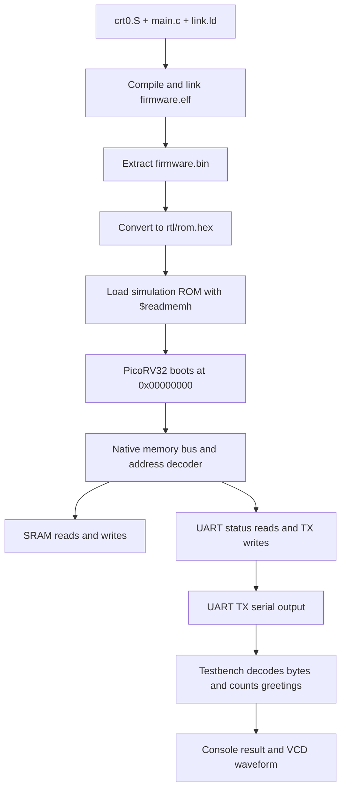
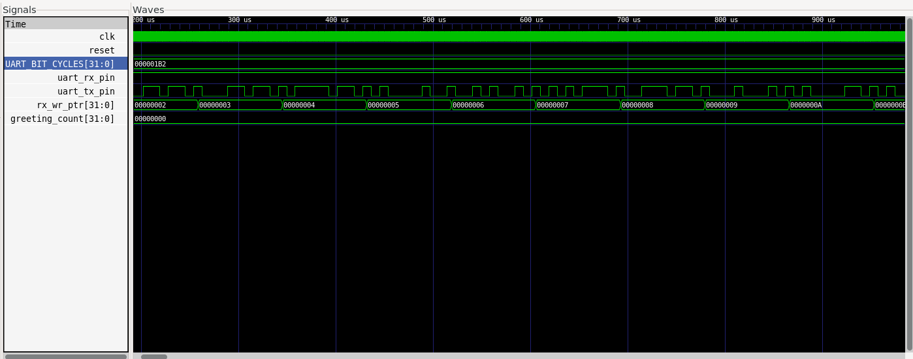
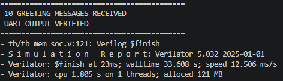

# PicoRV32 UART SoC Without AXI-Lite

## Purpose

This project demonstrates a bare-metal RV32I system that boots from ROM and sends a greeting over a memory-mapped UART. The CPU connects directly to ROM, SRAM, and UART through PicoRV32’s native memory interface. This version runs without an AXI-Lite interconnect or adapter.

## Method

Run the simulation from `picoRV32/` with Bash, GNU Make, a RISC-V GCC and binutils toolchain (`riscv64-unknown-elf-*`), Python 3, Verilator, and a C++ compiler. The script also attempts to launch GTKWave when it finds the waveform.

```bash
cd picoRV32
bash run.sh
```

1. The firmware build compiles `crt0.S` and `main.c` for RV32I using `link.ld`, extracts `firmware.bin`, and converts it into `rtl/rom.hex`. Each hex line represents one 32-bit ROM word.
2. Verilator builds `tb_mem_soc` and the SoC RTL into `obj_dir/`. If build dependencies reference a Verilator installation from another machine, move the existing `obj_dir/` aside and run the script again to regenerate it locally.
3. The testbench drives a 50 MHz clock and releases reset. The CPU fetches its first instruction at `0x00000000`, and the startup code calls `main()`.
4. Firmware polls the UART status register and writes each character to the TX register. The UART sends the bytes at 115,200 baud in 8N1 format. The testbench samples the TX pin and writes `tb_picorv32.vcd`.

### Process diagram



## Structure analysis

### Hardware block diagram

```text
                       +---------------------------+
                       |     PicoRV32 CPU Core     |
                       +-------------+-------------+
                                     |
                         Native Memory Interface
                                     |
                       +-------------v-------------+
                       |           top.v           |
                       | Address decode and mux    |
                       +-------------+-------------+
                                     |
              +----------------------+----------------------+
              |                      |                      |
     +--------v--------+    +--------v--------+    +--------v--------+
     |       ROM       |    |       SRAM      |    |       UART      |
     |  Program memory |    |   Data memory   |    | TX/RX registers |
     |      8 KiB      |    |     256 bytes   |    | and serial logic|
     +-----------------+    +-----------------+    +--------+--------+
                                                            |
                                                      uart_tx / uart_rx
```

The arrows show how requests reach the three peripherals. `top.v` returns the selected peripheral’s `mem_ready` and `mem_rdata` to the CPU over the same native interface.

### Source files

```text
picoRV32/
├── run.sh             Firmware build, Verilator simulation, and waveform launch
├── fw/
│   ├── Makefile       RV32I build and ROM image generation
│   ├── crt0.S         Startup code and entry point
│   ├── link.ld        ROM and SRAM layout
│   ├── main.c         UART polling and greeting program
│   ├── bin2hex.py     Binary-to-hex conversion for the simulation build
│   └── gen_rom_case.py  Standalone generator for an AXI-style ROM case table
├── rtl/
│   ├── top.v          CPU integration, address decoding, and response mux
│   ├── picorv32.v     PicoRV32 CPU RTL
│   ├── mem_rom.v      Boot ROM on the native memory bus
│   ├── mem_sram.v     SRAM with byte-write enables
│   ├── mem_uart.v     Memory-mapped UART registers and byte buffers
│   ├── uart_tx.v      UART serializer
│   ├── uart_rx.v      UART receiver
│   └── rom.hex        Generated simulation firmware image
└── tb/
    └── tb_mem_soc.v   Clock, reset, serial TX monitor, and greeting check
```

`top.v` selects a peripheral using `mem_addr` while `mem_valid` is high, then returns that peripheral’s `mem_ready` and read data to the CPU. A zero `mem_wstrb` marks a read. On writes, `mem_wstrb` identifies the active byte lanes. `mem_uart.v` buffers TX data so firmware can queue the next byte while the transmitter is busy.

| Device or register | Firmware address | Function |
| --- | --- | --- |
| ROM | `0x00000000`–`0x00001FFF` | 8 KiB for boot code and read-only data |
| SRAM | `0x00010000`–`0x000100FF` | 256 bytes for writable data and stack |
| UART TX | `0x10000000` | Write a byte for transmission |
| UART RX | `0x10000004` | Read the buffered received byte and clear its valid flag |
| UART status | `0x10000008` | Bit 0 indicates TX buffer space. Bit 1 indicates that RX data is available. |

These are the intended firmware addresses. The RTL selects broader address windows, so additional addresses can alias the same memory words or UART registers. During simulation the ROM loads `rtl/rom.hex`. With `SYNTHESIS` defined, `mem_rom.v` uses a separate hard-coded table, whose default case currently targets the undeclared `mem_data` signal.

## Simulation results

### UART transmit waveform



The capture zooms in on UART activity about 200–980 µs into the simulation. The testbench increments `rx_wr_ptr` as it decodes bytes from `uart_tx_pin`, roughly every **86.8 µs**. That interval matches the expected frame time at 115,200 baud with 8N1 framing. The first newline falls after the displayed window, so `greeting_count` is still zero in this view.

### Testbench completion



In the full trace, `greeting_count` and `line_count` both reach 10 at **22.576 ms** of simulated time. The UART monitor recorded 260 bytes, which match ten copies of `Hello!JunDai_Testbench!!!\n`. At 10 serial bits per byte, those frames account for about **22.57 ms** of transmission. The simulation generates the full trace as `tb_picorv32.vcd`.

The pass banner comes from the testbench's check for ten newline-terminated lines with 25 characters and an initial `H`. The full byte comparison comes from inspecting the trace separately. The testbench holds the DUT's UART RX pin high throughout the run, so this simulation exercises the transmit path.
